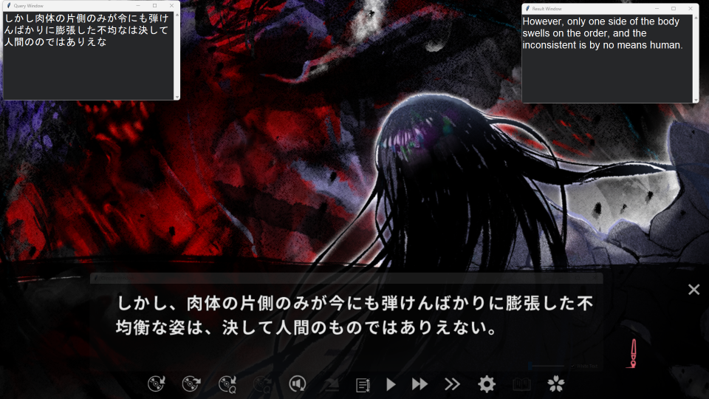

# Japanese CRNN Text Recognition & On-Screen Translator

An end-to-end Japanese Scene Text Recognition (OCR) pipeline built with PyTorch and trained on the ETL Character Database. The repository includes binary dataset extraction tools, synthetic dataset generators, CRNN training with CTC loss, and a real-time On-Screen Translator desktop application.



*Figure 1: Real-time OCR capture and translation running on a Japanese visual novel screenshot for demonstration purposes.*

---

## Features

- Custom CRNN Architecture: Combines deep CNN feature extraction, 1D convolution dimensionality reduction, Bidirectional LSTMs, and Multihead Self-Attention.
- ETL Dataset Extractor: Binary unpacker for ETL character database files (ETL1–ETL9) with dynamic UTF-8 mapping and image scaling.
- Line Image Generators: Automated scripts to generate synthetic horizontal and vertical character line samples for training.
- On-Screen Translator Desktop App: Modern Tkinter GUI with non-blocking async OCR screen region capture, EasyOCR bounding box detection, and live multi-engine translation (`translators`).

---

## Model Architecture

The model uses a modified Convolutional Recurrent Neural Network (CRNN) designed for sequence-to-sequence character recognition:

1. Feature Extractor: Deep CNN stack (`Conv2d` + `BatchNorm2d` + `ReLU` + `MaxPool2d`).
2. Dimensionality Reduction: `Conv1d` layer projecting features to a hidden dimension of 256.
3. Sequence Modeling: Two Bidirectional LSTM layers with multi-head self-attention (`MultiheadAttention`).
4. Decoder: Linear projection with Connectionist Temporal Classification (CTC) loss decoding.

---

## Project Structure

    japanese-crnn-text-recognition/
    ├── paper/                        # Research paper manuscript, PDF, or LaTeX sources
    │   └── Enhanced Convolutional Recurrent Neural Network for Vertical Japanese Text Recognition.pdf
    ├── data/                         # Generated vocab and training samples
    ├── samples/                      # Inference sample image files
    ├── tools/                        # Extraction utilities and submodules
    │   └── etlcdb-image-extractor/   # ETL binary dataset extractor and charset maps
    ├── .gitignore                    # Git ignore file
    ├── design.py                     # On-Screen Translator desktop GUI application
    ├── functions.py                  # Helper functions and CTC output decoder
    ├── generate_horizontal.py        # Synthetic horizontal line image generator
    ├── generate_vertical.py          # Synthetic vertical line image generator
    ├── infer.py                      # Command-line OCR inference script
    ├── main.py                       # Pipeline execution entry point
    ├── model.py                      # CRNN PyTorch network architecture definition
    ├── README.md                     # Project documentation
    ├── requirements.txt              # Project dependencies
    ├── train.py                      # CRNN training script with CTC loss and validation
    └── train_log.txt  

## Training progress log
    Epoch [1/100] - Train Loss: 4.7411
    Validation Loss: 0.6428 | CER: 0.0442
    Epoch [2/100] - Train Loss: 0.1393
    Validation Loss: 0.0516 | CER: 0.0047
    Epoch [3/100] - Train Loss: 0.0324
    Validation Loss: 0.0266 | CER: 0.0040
    Epoch [4/100] - Train Loss: 0.0193
    Validation Loss: 0.0225 | CER: 0.0028
    Epoch [5/100] - Train Loss: 0.0158
    Validation Loss: 0.0247 | CER: 0.0034
    Epoch [6/100] - Train Loss: 0.0116
    Validation Loss: 0.0150 | CER: 0.0019
    Epoch [7/100] - Train Loss: 0.0125
    Validation Loss: 0.0191 | CER: 0.0030
    Epoch [8/100] - Train Loss: 0.0141
    Validation Loss: 0.0162 | CER: 0.0027
    Epoch [9/100] - Train Loss: 0.0119
    Validation Loss: 0.0146 | CER: 0.0024
    Epoch [10/100] - Train Loss: 0.0078
    Validation Loss: 0.0151 | CER: 0.0021


---

## Getting Started

### Prerequisites

- Python 3.12+
- CUDA 12.4 compatible GPU (recommended for real-time inference and fast training)

### Installation

1. Clone the repository:
```bash
git clone [https://github.com/Xreactives/japanese-crnn-text-recognition.git](https://github.com/Xreactives/japanese-crnn-text-recognition.git)
cd japanese-crnn-text-recognition
```

2. Create and activate a virtual environment:
```bash
python -m venv .venv
# On Windows PowerShell:
.\.venv\Scripts\Activate.ps1
# On Linux/macOS:
source .venv/bin/activate
```


3. Install dependencies:
```bash
pip install -r requirements.txt
```


---

## Usage

### 1. Extract ETL Dataset

Extract raw ETL binary data into structured PNG image files:

```bash
python tools/etlcdb-image-extractor/etl_extractor.py
```

### 2. Generate Training Datasets

Generate horizontal or vertical text line samples along with vocabulary mappings (`vocab.pkl`):

```bash
python generate_horizontal.py
python generate_vertical.py
```

### 3. Train Model

Train the CRNN model on the generated dataset:

```bash
python train.py
```

*Trained checkpoints will be saved to `checkpoints/best_crnn.pth`.*

### 4. Run Single Image Inference

Predict text from a single line image:

```bash
python infer.py --image "samples/test_line.png"
```

### 5. Launch On-Screen Translator App

Run the desktop capture GUI application:

```bash
python design.py
```

---

## On-Screen Translator Features

* Capture Window: Draggable translucent capture area with real-time text binarization controls (White/Dark text toggle).
* Multi-Engine Translation: Support for Google Translate, Bing, Yandex, DeepL, and Baidu via `translators`.
* Query & Result Windows: Separate floating sub-windows for input and translated text monitoring.

---

## Research Paper

The methodology, architecture design, and experimental benchmarks on the ETL dataset are detailed in our manuscript:

* **PDF Manuscript**: [`IJECSA Article Link`](https://journal.universitasbumigora.ac.id/IJECSA/article/view/6620/2634)

### Abstract

> Optical Character Recognition (OCR) plays a crucial role in text digitization, yet most existing research predominantly focuses on horizontal English or Latin text, leaving vertical Japanese text largely underexplored. This research addresses that gap by proposing an enhanced Convolutional Recurrent Neural Network (CRNN) model tailored for Japanese vertical text recognition. The novelty of this work lies in integrating residual connections and attention mechanisms into the CRNN, along with a custom dataset that includes both Japanese characters and 30% Latin characters, simulating real-world scenarios such as manga. Experimental results show that the proposed model achieves a Character Error Rate (CER) of 0.363% in only 10 epochs, compared to the baseline CRNN, which reaches 2.084% CER after 100 epochs, demonstrating both faster convergence and improved accuracy. Furthermore, evaluation on manga screenshots from the Manga109 dataset highlights the model’s practical potential, while also revealing new challenges related to irregular vertical spacing and font variability. These findings indicate that the proposed method significantly advances vertical Japanese text recognition and offers a foundation for future improvements in text recognition for manga and similar media.

### Citation

If you find this work or implementation useful in your research, please cite our paper:

```bibtex
@article{Ronny_Kosasi_David_2026, 
    title={Enhanced Convolutional Recurrent Neural Network for Vertical Japanese Text Recognition}, 
    volume={5}, 
    url={https://journal.universitasbumigora.ac.id/IJECSA/article/view/6620}, 
    DOI={10.30812/ijecsa.v5i2.6620}, 
    abstractNote={Optical Character Recognition (OCR) plays a crucial role in text digitization, yet most existing research predominantly focuses on horizontal English or Latin text, leaving vertical Japanese text largely underexplored. This research addresses that gap by proposing an enhanced Convolutional Recurrent Neural Network (CRNN) model tailored for Japanese vertical text recognition. The novelty of this work lies in integrating residual connections and attention mechanisms into the CRNN, along with a custom dataset that includes both Japanese characters and 30% Latin characters, simulating real-world scenarios such as manga. Experimental results show that the proposed model achieves a Character Error Rate (CER) of 0.363% in only 10 epochs, compared to the baseline CRNN, which reaches 2.084% CER after 100 epochs, demonstrating both faster convergence and improved accuracy. Furthermore, evaluation on manga screenshots from the Manga109 dataset highlights the model’s practical potential, while also revealing new challenges related to irregular vertical spacing and font variability. These findings indicate that the proposed method significantly advances vertical Japanese text recognition and offers a foundation for future improvements in text recognition for manga and similar media.},  
    number={2}, 
    journal={International Journal of Engineering and Computer Science Applications (IJECSA)}, 
    author={Ronny, Ronny and Kosasi, Sandy and David, David}, 
    year={2026}, 
    month={Aug.}, 
    pages={55–60} 
    }

```

---

## Acknowledgements

* **ETL Dataset Extractor**: Adapted from the open-source ETL extraction tools for processing raw ETL binary files.

---
